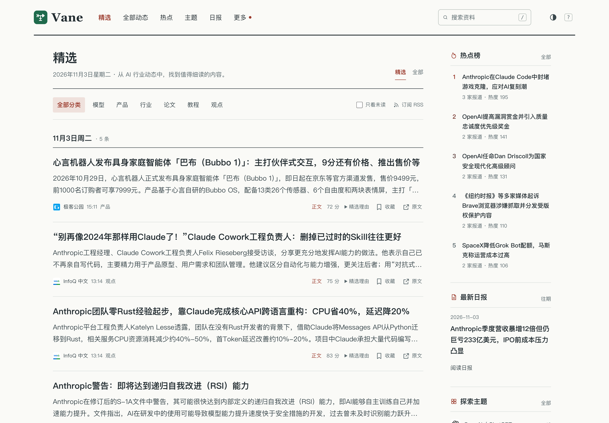
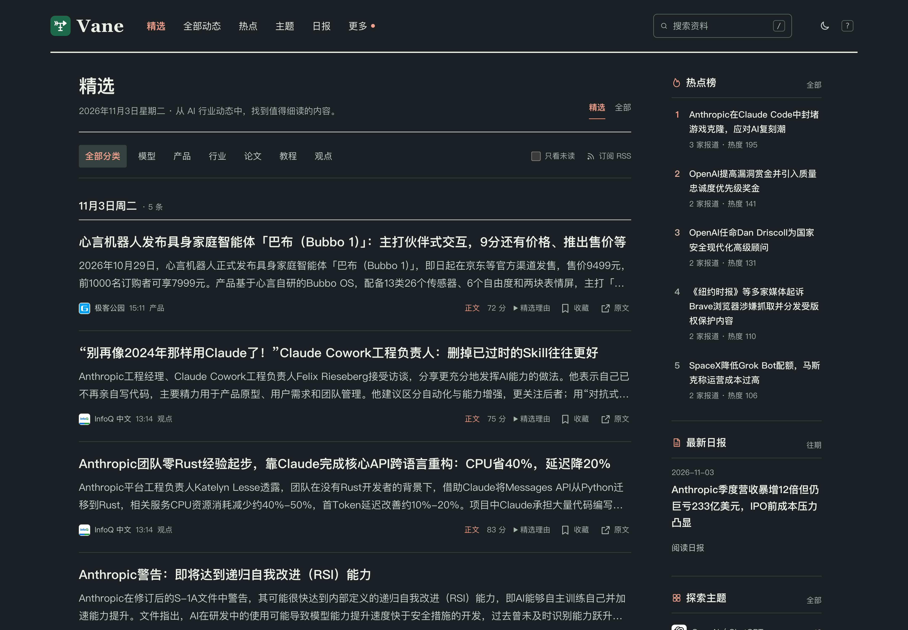

<p align="center">
  
</p>
<h1 align="center">Vane</h1>
<p align="center">自托管的 AI 资讯聚合与精选站。</p>
<p align="center">
  <a href="LICENSE"></a>
  <a href="go.mod"></a>
  <a href="web/package.json"></a>
  <a href="https://github.com/bogeia/Vane/actions/workflows/go.yml"></a>
</p>
<p align="center">简体中文 · <a href="README_en.md">English</a></p>

[](docs/images/selected-light.png)

<details>
<summary>深色主题</summary>

[](docs/images/selected-dark.png)

</details>

当前精选页的栏目式布局，浅色与深色截图均为 3× 高清截图；点击图片可查看原图。

Vane 从 RSS、网站和 Hugging Face 收集资料，通过大模型预筛、评分和生成中文摘要，将同一事件的报道聚合起来。你可以浏览精选、追踪公司与技术主题、订阅日报，也可以通过 RSS、API 或 MCP 把内容接入自己的工具。

发布记录见 [GitHub Releases](https://github.com/bogeia/Vane/releases)。

## 功能

- **多种信源**：RSS / Atom、网页列表和 Hugging Face 模型发布；支持 OPML 导入预览、屏蔽词和信源健康统计。
- **中文精选**：AI 相关性预筛、两次独立评分、中文标题与摘要；同一事件在精选中折叠展示。
- **主题与事件**：按公司、技术方向和内容形态浏览，查看事件时间线与多家报道。
- **HN 社区讨论**：可选后台独立采集近 7 天 HN 帖子与真实顶层评论，核对原始标题、结构化事实、完整版本与发生时间后关联同一次具体事件。最多采样 10 条有效顶层评论，生成最多 3 条带出处的中文要点，在事件页与事件详情 API 展示采样量和更新时间；仅代表评论样本，不代表全社区共识，也不影响精选、评分或热度。
- **热点与日报**：按多源报道计算热点，每天北京时间 08:00 起生成日报；支持企业微信、飞书推送和信源告警。
- **阅读体验**：搜索、收藏、已读过滤、深浅主题、键盘快捷键和手机布局。收藏与已读保存在当前浏览器，无需账号。
- **开放接口**：JSON API、分类 RSS、OPML、面向 AI 助手的 Markdown 接口与 MCP。

后端使用 Go、Echo、Huma、GORM 和 PostgreSQL，前端使用 React、TypeScript 和 Vite。

## 快速开始

可选择源码运行或 [Docker 部署](#docker-部署)。源码运行需要下列 Go、Node.js 和自备 PostgreSQL；Docker 路径只需 Docker（含 Compose）和 `openssl`，Go、Node.js 由镜像构建阶段提供。两种方式都先克隆仓库；Docker 用户随后跳到 Docker 部署准备独立配置。

```sh
git clone https://github.com/bogeia/vane.git
cd vane
```

### 源码运行：环境准备

- Go **1.25.11 或更新版本**。
- Node.js **24 或更新版本**，以及 npm。
- 可访问的 **PostgreSQL 16** 实例和一个供 Vane 使用的数据库。

```sh
cp configs/config.example.yaml configs/config.yaml
cp configs/sources.example.yaml configs/sources.yaml
```

编辑 `configs/config.yaml`：

| 配置 | 设置方式 |
| --- | --- |
| `database.url` | 填写数据库连接地址，连接用户需要建表权限 |
| `site.public_url` | 填写访问站点的地址，本机可用 `http://localhost:8080` |
| `collect.enabled` | 设为 `true`，启用信源采集 |
| `llm.enabled` | 设为 `true`，启用预筛、评分、写作和归组 |
| `llm.base_url`、`api_key`、`model` | 配置兼容 OpenAI Chat Completions 的模型服务；端点需要 `/v1` 时将其包含在 `base_url` 中 |
| `llm.steps.*.reasoning_effort` | 按模型端点能力填写；不支持该参数时设为空字符串 |

示例默认关闭采集和模型调用。只启用采集时，资料留在待处理队列；处理完成后才会出现在公开页面。启用模型会产生相应的调用费用。

### 构建并运行

在仓库根目录执行：

```sh
npm ci --prefix web
npm run build --prefix web
make build
./bin/vane serve --conf configs/config.yaml
```

打开 [http://localhost:8080](http://localhost:8080)。首次启动会创建表并同步信源，采集和模型处理在后台进行，页面不会立即有内容。可在另一个终端查看进度：

```sh
./bin/vane status --conf configs/config.yaml --days 7
```

服务使用 `web.dir` 指向的目录提供前端资源，示例为 `web/dist`。单独运行 `make build` 只构建后端；更新前端后需要重新执行 `npm run build --prefix web`。

## 配置

完整字段与示例值见 [主配置示例](configs/config.example.yaml)和[信源示例](configs/sources.example.yaml)。源码运行使用 `configs/config.yaml`、`configs/sources.yaml`；Docker 使用独立的 `configs/docker/config.yaml`、`configs/docker/sources.yaml`，挂载后位于容器内 `/data/conf/`。这些私有配置均被 Git 和 Docker 构建上下文忽略。

所有命令通过 `--conf` 指定主配置。主配置的 `sources_file` 指向信源文件，相对路径以主配置所在目录解析。运行配置不读取环境变量；字段需要显式填写，主配置与信源配置均拒绝未知字段（包括嵌套字段）；升级时请对照示例补齐新增字段并移除废弃字段。

### 信源

源码运行编辑 `configs/sources.yaml`，Docker 部署编辑 `configs/docker/sources.yaml`。在 `sources.official`（官方一手）和 `sources.media`（媒体与个人）两组中维护信源。两组都必须写出，没有信源时写 `[]`；每个信源不再填写 `tier`，程序按所在分组赋值，ID 在两组之间也必须唯一。旧的平铺列表不再接受。支持以下类型：

| `kind` | `feed_url` | 说明 |
| --- | --- | --- |
| `rss` | RSS / Atom 地址 | 直接订阅信源 |
| `web_list` | 网站列表页地址 | 同时配置 `web_list` 中的条目、链接、标题和日期选择器；使用前确认网站允许抓取 |
| `hf_models` | `https://huggingface.co/<org>` | 采集最近 30 天创建的模型仓库；示例屏蔽规则排除 FP8、BF16、GGUF 等格式变体 |

HN 讨论通过 `community.enabled` 启用，`community.refresh_interval` 控制刷新周期（公开示例为关闭 / `30m`）。每轮扫描 HN topstories 与 newstories 各前 50 条，去重后最多发现 100 个帖子；先采集并持久化，再核验事件关联，未匹配的帖子仍保留在采集池。精确 URL 只提供线索，仍须核对具体对象、动作、完整版本与发生时间；缺证据、冲突或歧义均不关联，因此没有摘要不等于没有讨论。只采顶层评论，不采递归回复；成功空结果会清空旧要点，临时失败可保留仍有效的旧结果，超过 24 小时未确认则隐藏。网页读取和事件详情 API 不触发采集或模型调用；讨论不扩展到日报、RSS 或 Agent 输出。

信源图标由后端在服务启动时独立补全，已有信源也会处理，不阻塞资料采集。已校验的原图与输入指纹缓存在 PostgreSQL，前端使用 API 的 `source.icon_url`；重建前端不会清空图标。优先复用内置发布者 SVG，否则比较订阅图像、官网图标和 favicon 的真实质量；保留尺寸比例，不把低清图放大成高清。远程 SVG 只接受静态图形白名单，不接受脚本、事件属性、CSS、外部引用和 DOCTYPE；位图限制格式、字节数与解码尺寸。

每个信源可选填 `icon_url: https://example.com/publisher-icon.svg` 来纠正自动发现；省略此字段使用自动发现，显式 URL 无效时保留首字头像。修改图标 URL 或信源地址后重启会重新发现；失败项在下次服务启动时及运行期间每 6 小时重试。Hugging Face 信源使用发布者品牌或组织头像，避免显示平台图标。图标抓取沿用 `fetch` 的代理、超时、有限重试和公网地址校验。

新增或调整信源后，可先预览解析结果：

```sh
./bin/vane sources preview --conf configs/config.yaml --id web-anthropic-news
```

预览最多返回 20 条，不写数据库、不调用模型，也不应用屏蔽词。`status` 可查看采集错误和近期屏蔽记录。

### 模型与精选

`llm.steps.prefilter`、`score`、`write`、`group` 可分别配置模型地址、密钥和模型名；空字符串表示继承对应的全局值。`reasoning_effort` 为空时不发送该参数。

精选门槛由 `selection.thresholds.official` 和 `selection.thresholds.media` 控制。两次评分的平均值达到门槛且不是综合稿，资料才入选；调整门槛只影响之后处理的资料。可以用下方的评测命令校准自己的模型与信源。

新入选的精选资料会按三类内容增强摘要：产品发布突出更新、适用人群与限制，论文研究突出问题、方法、结果与局限，技术教程突出问题、适用条件与关键步骤。产品须能确定为发布或更新；模型分类不纳入产品发布。类型不确定、原文信息不足、其他类型或非精选资料保留基础摘要，不补写原文没有提供的信息。

增强在基础写作与两次评分完成、判定精选后执行，复用 `llm.steps.write` 的设置、请求超时与有限重试。增强失败、超时、拒答、空输出或退化输出时，保留合格基础摘要；不改变标题、分类、事实、标签、评分或推荐理由。符合条件的资料通常多一次模型调用及相应耗时，HTTP 重试可能增加调用数与费用。基础摘要在内部留存以供质量抽检，不新增公开字段；信息流、新日报与其他摘要接口使用同一份最终摘要，历史资料及既有日报快照不回填。

模型日志按每次 HTTP 尝试记录步骤、模型、结果、耗时及可获得的输入/输出 token；缺失用量记为 `unknown`，不当作零。`http_success` 仅表示 HTTP 和基本 JSON 响应成功，不代表摘要质量验收通过；增强成功或回退另由业务日志记录。日志不输出模型地址、密钥、请求材料或响应正文，也不估算缺少可靠单价的费用。字段说明见[模型调用日志](internal/infra/llm/README.md)。发布前仍须完成三类各 10 条的人工抽检，自动化检查不能替代人工摘要质量验收。

主题索引同时显示精选数和全部资料数。没有精选但有资料的主题默认展示全部，手动切换后以读者选择为准。公司主题优先使用模型提取的主体；主体为空时，标题和原标题只命中一家公司的才归入该主题。

### 出口代理

无法直连海外信源时，设置 `fetch.proxy_url`；直连时保留空字符串：

```yaml
fetch:
  proxy_url: "http://127.0.0.1:7890"
  # 其余 fetch 字段保留完整示例中的配置。
```

只支持带主机和端口的 HTTP 代理，可带账号密码。代理用于信源、原文、HF 接口及信源预览和导入探测；模型调用与推送仍直连。代理模式经代理访问 Cloudflare DoH，校验解析出的全部 IP 为公网地址后，再 CONNECT 到指定 IP；重定向同样校验，解析失败不会回退系统 DNS。

### 推送与过滤

在 `push.webhooks` 中配置企业微信或飞书机器人。`daily` 控制日报，`alerts` 控制信源告警，`realtime` 控制实时推送。默认空列表，不发送消息。

下面是单个 webhook 的实时推送配置，按主题和关注词筛选：

```yaml
realtime:
  enabled: true
  scope: all
  topics: [anthropic]
  words:
    - [Claude, Anthropic, '+发布', '!招聘']
```

`scope` 为 `selected` 或 `all`；启用 `all` 时至少指定主题或关注词。主题与关注词同时配置时取交集。每个词组至少含一个普通词或 `/正则/`，多个组之间取并集；组内普通词至少命中一个，所有 `+词` 都要命中，命中任意 `!词` 则排除该组。英文不区分大小写，正则使用 Go RE2 语法。

信源的 `block` 使用相同词组语法，匹配原标题，命中后在采集阶段跳过。无需屏蔽时显式写 `block: []`。机器人地址和签名密钥只保存在私有配置中。

## Docker 部署

仓库提供 [Dockerfile](Dockerfile) 和 [Docker Compose 配置](docker-compose.yaml)，镜像包含前端与后端。Compose 同时运行 PostgreSQL 16，数据库仅供容器网络访问，不向宿主机开放 5432 端口；站点使用宿主机 8082 端口，避免与已有的 8080 服务冲突。

在仓库根目录准备独立的 Docker 配置和数据库密码。以下命令只创建缺失文件，保留已有配置和密码，不影响原生运行的 `configs/config.yaml`、`configs/sources.yaml`：

```sh
mkdir -p configs/docker secrets
[ -e configs/docker/config.yaml ] || cp configs/config.example.yaml configs/docker/config.yaml
[ -e configs/docker/sources.yaml ] || cp configs/sources.example.yaml configs/docker/sources.yaml
(umask 077; set -C; [ -e secrets/postgres_password ] || openssl rand -hex 32 > secrets/postgres_password)
```

已有 Compose 部署升级时，先将原来的私有配置手动复制到 `configs/docker/`（保留原件，并避免覆盖该目录已有文件），再按下文修改连接地址；原先外部数据库的数据不会自动导入新数据库，需要保留时先备份并迁移。

编辑 `configs/docker/config.yaml`，保留完整示例中的其他字段，修改以下配置：

```yaml
server:
  address: :8080
  # 其余 server 字段保留完整示例中的配置。
database:
  max_open_conns: 5
  max_idle_conns: 2
  conn_max_lifetime: 30m
  url: postgres://vane:<password>@postgres:5432/vane?sslmode=disable
site:
  name: Vane
  public_url: http://localhost:8082
```

将 `<password>` 替换为 `secrets/postgres_password` 中的同一密码，不能直接保留占位符。上述命令生成的十六进制密码可直接用于连接 URL。远程访问时将 `site.public_url` 改为实际访问地址；`web.dir` 保持 `web/dist`，`sources_file` 保持 `sources.yaml`。按需编辑独立信源文件 `configs/docker/sources.yaml`；采集和模型调用的开启方式见快速开始。如使用出口代理，其地址必须能从容器访问。

```sh
# 下载 PostgreSQL 镜像
docker compose pull postgres
# 构建 Vane，并启动数据库和站点；数据库健康检查通过后才启动 Vane
docker compose up -d --build
docker compose logs -f vane
```

打开 [http://localhost:8082](http://localhost:8082)。PostgreSQL 使用独立的 `vane` 账号和 `vane` 数据库，设置 `shared_buffers=32MB`、`max_connections=20`，容器内存上限为 512 MB，共享内存为 64 MB。

Compose 将 `configs/docker/` 只读挂载到 `/data/conf`，将 `logs/` 挂载到 `/app/logs`，数据库数据持久化在 `postgres/`，密码文件只读挂载到数据库容器。这些 Docker 私有配置、密码和数据目录均已被 Git 和 Docker 构建上下文忽略。`docker compose down` 不会删除宿主机的持久数据；不要删除 `postgres/`，升级前先备份。

密码文件仅在空数据目录首次初始化时设置数据库密码；修改该文件不会更改已有数据库账号的密码。已有数据需要通过 PostgreSQL 修改账号密码，再同步更新密码文件和 Vane 的 `database.url`。公开部署时建议通过反向代理提供 HTTPS，并为匿名只读的 Agent API 和 MCP 配置限流。

项目仍在开发阶段，配置和数据模型可能变化，目前不提供旧数据迁移兼容保证。升级前备份数据库与私有配置，并阅读[数据模型维护约定](docs/adr/0002-gorm-model-migrations.md)。

## 常用命令

以下命令用于源码运行，在仓库根目录执行。Docker 部署可将 `./bin/vane` 换为 `docker compose exec vane ./vane`，并将 `--conf configs/config.yaml` 换为 `--conf /data/conf/config.yaml`；命令涉及的文件路径也须在容器内可访问。完整参数可用 `./bin/vane --help` 及子命令的 `--help` 查看。

```sh
# 查看信源健康与处理队列，不执行迁移或信源同步
./bin/vane status --conf configs/config.yaml --days 7

# 检查 OPML 并输出不含 tier 的信源 YAML 列表，按开头注释粘到 sources.media 下
./bin/vane sources import --conf configs/config.yaml --opml feeds.opml --tier media --interval 30

# 按北京时间日期生成或覆盖日报；不会自动推送
./bin/vane report --conf configs/config.yaml --date 2026-10-27

# 手动推送已生成的日报；允许重复推送
./bin/vane push --conf configs/config.yaml --date 2026-10-27

# 按当前规则重算已完成资料的主题，不重算精选
./bin/vane topics rebuild --conf configs/config.yaml
```

评测使用人工标注的数据，运行结果不会自动修改门槛或已发布资料：

```sh
./bin/vane eval export --conf configs/config.yaml --out gold.yaml --days 7 --n 200
# 编辑 gold.yaml，核对每条 label：select、reject 或 either
./bin/vane eval run --conf configs/config.yaml --gold gold.yaml
```

`eval export` 从已完成资料中抽样，目标文件必须不存在。`eval run` 实际调用模型、输出分级指标和建议门槛，不写数据库。导出时预填的标签来自当前精选结果，需要人工复核后才能作为评测依据。

## 订阅与接口

以下路径相对于你的站点地址：

| 入口 | 用途 |
| --- | --- |
| `/feed.xml` | 精选 RSS，按事件折叠 |
| `/feed/all.xml` | 全部动态 RSS |
| `/feed/daily.xml` | 日报 RSS |
| `/feed/category/{slug}.xml` | 分类精选 RSS：`model`、`product`、`industry`、`paper`、`tutorial`、`opinion` |
| `/api/source-icons/:id` | 已缓存信源原图（GET / HEAD） |
| `/sources.opml` | 启用信源的 OPML 列表 |
| `/docs`、`/openapi.json` | JSON API 文档与 OpenAPI 定义 |
| `/agent`、`/llms.txt` | AI 助手接入说明 |
| `/api/agent` | Markdown 使用说明及内容查询入口 |
| `/api/mcp` | MCP Streamable HTTP 端点 |
| `/healthz` | 服务健康检查 |

本项目自有 JSON 字段统一使用 `snake_case`，HTTP API、CLI JSON 输出及前端直接使用同一字段名，例如 `original_title`、`published_at`、`story_id`、`next_cursor`。分页结束时省略 `next_cursor`，响应示例：

```json
{"items": []}
```

浏览器收藏和已读记录也使用 `source_name`、`published_at`、`favorited_at`、`read_at` 等字段，不迁移旧格式。OpenAPI、MCP/JSON-RPC 和第三方 API 的标准字段保持各自协议；数据库内部快照独立于公开 DTO，不随公开字段改名。

MCP 客户端使用 `https://你的域名/api/mcp` 连接。仅支持网页读取的助手可以先访问 `/api/agent`，按说明查询最新资料、搜索、热点、事件和日报。这些接口匿名只读，不会触发即时模型处理。

## 开发与贡献

欢迎通过 [Issues](https://github.com/bogeia/vane/issues) 报告问题或讨论功能，通过 [Pull requests](https://github.com/bogeia/vane/pulls) 提交修改。报告问题时请附复现步骤和已脱敏的错误信息。

前端开发使用 `npm run dev --prefix web`，默认地址为 `http://localhost:5173`，接口代理到本机 8080 后端。后端可用 `go run ./cmd/vane serve --conf configs/config.yaml` 启动。

```sh
npm test --prefix web
npm run build --prefix web
go vet ./...
go test -race ./...
```

数据库集成测试需单独配置名为 `vane_test` 的数据库；未设置时会跳过。**测试会重建该库的 `public` schema，必须使用独立测试库。**

```sh
VANE_TEST_DATABASE_URL='postgres://localhost:15432/vane_test?sslmode=disable' go test -race ./internal/integration -count=1
```

修改 Wire 装配后执行 `make generate`；所需工具可用 `make init` 安装。架构与变更检查见 [AGENTS.md](AGENTS.md)，领域术语见 [GLOSSARY.md](GLOSSARY.md)，设计决策见 [docs/adr](docs/adr)。

## 致谢与许可

Vane 基于 [echo-layout](https://github.com/bogeia/echo-layout) 构建。预筛、评分、词表和部分内容规则来源于 [AIHOT](https://github.com/KKKKhazix/AIHOT)，使用范围见 [NOTICE](NOTICE)。产品与工程设计也参考了 ai-news-radar、Horizon、TrendRadar、Folo 和 Miniflux。

本项目采用 [MIT License](LICENSE)。第三方内容的署名与许可见 [NOTICE](NOTICE)；公司图标的来源与许可见 [图标说明](web/public/logos/companies/README.md)。
