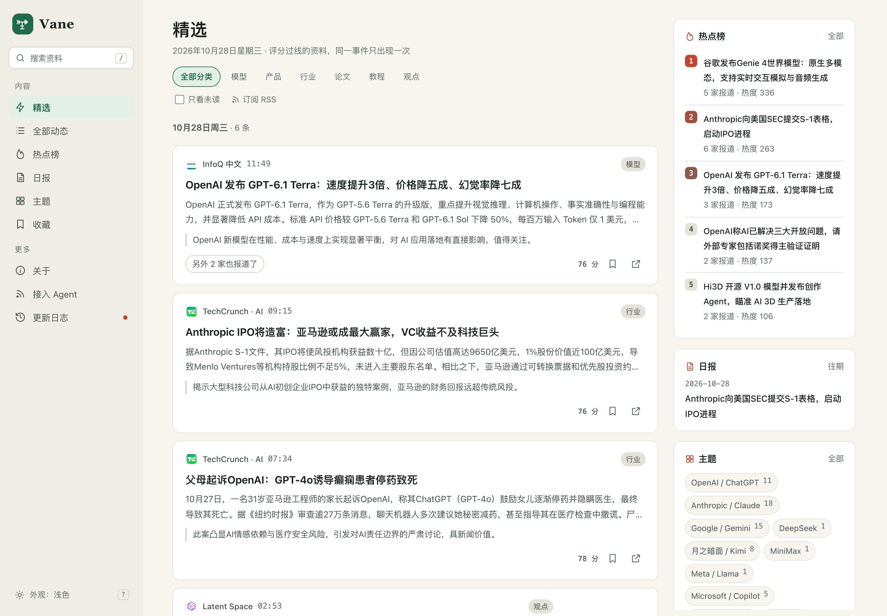
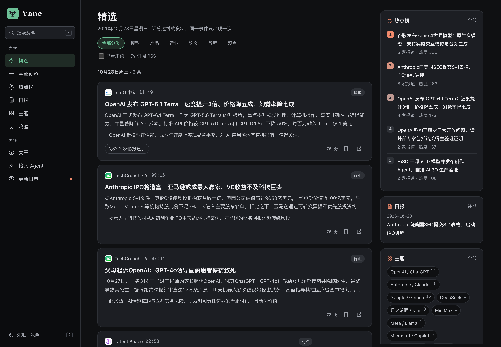

<p align="center">
  
</p>
<h1 align="center">Vane</h1>
<p align="center">A self-hosted AI news aggregator with curated picks.</p>
<p align="center">
  <a href="LICENSE"></a>
  <a href="go.mod"></a>
  <a href="web/package.json"></a>
  <a href="https://github.com/bogeia/Vane/actions/workflows/go.yml"></a>
</p>
<p align="center"><a href="README.md">简体中文</a> · English</p>



<details>
<summary>Dark theme</summary>



</details>

Vane collects material from RSS feeds, websites, and Hugging Face. It uses language models to screen for relevance, score items, and write Chinese summaries, then groups coverage of the same story. Browse curated picks, follow companies and technical topics, subscribe to daily reports, or connect your own tools through RSS, the API, or MCP. **The interface and generated content are primarily in Chinese; this is the English setup and usage guide.**

## Features

- **Multiple source types:** RSS / Atom, website listings, and Hugging Face model releases; OPML import previews, block words, and source health statistics.
- **Chinese-language curation:** AI relevance screening, two independent scores, Chinese titles and summaries; coverage of the same story is collapsed in the curated feed.
- **Topics and stories:** Browse by company, technical field, or content format, with story timelines and coverage from multiple sources.
- **Hot ranking and daily reports:** Rank stories by multi-source coverage; generate daily reports starting at 08:00 Beijing time; send reports and source alerts through WeCom or Feishu.
- **Reading tools:** Search, favorites, unread filtering, light and dark themes, keyboard shortcuts, and mobile layouts. Favorites and reading history stay in the current browser; no account is required.
- **Open interfaces:** JSON API, category RSS feeds, OPML, Markdown endpoints for AI assistants, and MCP.

The backend uses Go, Echo, Huma, GORM, and PostgreSQL. The frontend uses React, TypeScript, and Vite.

## Quick start

### Prerequisites

- Go **1.25.11 or later**.
- Node.js **24 or later**, with npm.
- An accessible **PostgreSQL 16** instance and a database for Vane.

```sh
git clone https://github.com/bogeia/vane.git
cd vane
cp configs/config.example.yaml configs/config.yaml
cp configs/sources.example.yaml configs/sources.yaml
```

Edit `configs/config.yaml`:

| Setting | What to configure |
| --- | --- |
| `database.url` | Database connection URL; the database user needs permission to create tables |
| `site.public_url` | Your site's public URL; use `http://localhost:8080` locally |
| `collect.enabled` | Set to `true` to enable source collection |
| `llm.enabled` | Set to `true` to enable screening, scoring, writing, and grouping |
| `llm.base_url`, `api_key`, `model` | An OpenAI Chat Completions-compatible model endpoint; include `/v1` in `base_url` if the endpoint requires it |
| `llm.steps.*.reasoning_effort` | Set according to the endpoint's capabilities; use an empty string if unsupported |

Collection and model calls are disabled in the example configuration. With collection alone enabled, items stay in the processing queue; only completed items appear on public pages. Enabling models incurs provider charges.

### Build and run

Run from the repository root:

```sh
npm ci --prefix web
npm run build --prefix web
make build
./bin/vane serve --conf configs/config.yaml
```

Open [http://localhost:8080](http://localhost:8080). The first startup creates tables and synchronizes sources. Collection and model processing run in the background, so content will not appear immediately. Check progress from another terminal:

```sh
./bin/vane status --conf configs/config.yaml --days 7
```

The server serves frontend assets from `web.dir`, which is `web/dist` in the example configuration. `make build` only builds the backend; rebuild the frontend with `npm run build --prefix web` after frontend changes.

## Configuration

See the [main configuration example](configs/config.example.yaml) and [source example](configs/sources.example.yaml) for fields and example values. The private `configs/config.yaml` and `configs/sources.yaml` files are excluded from Git and the Docker build context.

Every command selects the main configuration with `--conf`. Its `sources_file` points to the source file; relative paths resolve against the main configuration's directory. Runtime configuration does not read environment variables. Fields must be explicit, and unknown fields—including nested fields—are rejected in both configuration files. When upgrading, compare against the examples, add newly required fields, and remove obsolete ones.

### Sources

Edit `configs/sources.yaml`, maintaining sources under `sources.official` (official, first-party sources) and `sources.media` (media and individuals). Both groups must be present; write `[]` for an empty group. Do not set `tier` on individual sources: the group determines it. IDs must be unique across both groups. The old flat list format is not accepted. Supported types:

| `kind` | `feed_url` | Description |
| --- | --- | --- |
| `rss` | RSS / Atom URL | Subscribe directly to a source |
| `web_list` | Website listing URL | Also configure item, link, title, and date selectors under `web_list`; confirm that the website permits crawling |
| `hf_models` | `https://huggingface.co/<org>` | Collect model repositories created in the last 30 days; the example block rules exclude format variants such as FP8, BF16, and GGUF |

The backend completes source icons independently at startup, including for existing sources, without blocking item collection. Validated originals and input fingerprints are cached in PostgreSQL. The frontend uses the API's `source.icon_url`; rebuilding it does not clear icons. Built-in publisher SVGs take precedence; otherwise Vane compares the actual quality of feed images, website icons, and favicons. It preserves aspect ratios and does not upscale low-resolution images into high-resolution ones. Remote SVGs must pass a static graphics allowlist: scripts, event attributes, CSS, external references, and DOCTYPE are rejected. Raster formats, byte sizes, and decoded dimensions are restricted.

Each source may optionally set `icon_url: https://example.com/publisher-icon.svg` to correct automatic discovery. Omit the field for automatic discovery; an invalid explicit URL leaves the initial-letter avatar in place. Changing the icon URL or source URL triggers rediscovery after restart. Failed items are retried at the next startup and every 6 hours while the service runs. Hugging Face sources use publisher branding or organization avatars rather than the platform logo. Icon fetching uses the same proxy, timeouts, bounded retries, and public-address validation as `fetch`.

Preview a new or updated source before using it:

```sh
./bin/vane sources preview --conf configs/config.yaml --id web-anthropic-news
```

A preview returns at most 20 items, writes nothing to the database, does not call models, and does not apply block words. Use `status` to inspect collection errors and recently blocked items.

### Models and curated picks

`llm.steps.prefilter`, `score`, `write`, and `group` can each override the model endpoint, API key, and model name. An empty string inherits the corresponding global value. An empty `reasoning_effort` omits that parameter from requests.

`selection.thresholds.official` and `selection.thresholds.media` control curation thresholds. An item is selected only if the average of its two scores meets the threshold and it is not a roundup. Threshold changes only affect subsequently processed items. Use the evaluation commands below to calibrate your models and sources.

The topic index shows both selected and total item counts. Topics with items but no selected items default to the complete feed; a reader's manual selection takes precedence afterward. Company topics primarily use model-extracted subject companies. If no subject is available, an item belongs to a company topic only when its title and original title match exactly one company.

### Egress proxy

If overseas sources are unreachable directly, set `fetch.proxy_url`; leave it empty for direct access:

```yaml
fetch:
  proxy_url: "http://127.0.0.1:7890"
  # Keep the remaining fetch fields from the full example configuration.
```

Only HTTP proxies with a hostname and port are supported; credentials are optional. The proxy handles source and article fetching, Hugging Face requests, source previews, and import probes. Model calls and push delivery still connect directly. In proxy mode, Vane accesses Cloudflare DoH through the proxy, verifies that all resolved IPs are public, and then sends CONNECT to the validated IP. Redirects receive the same checks. DNS failures do not fall back to system DNS.

### Push delivery and filtering

Configure WeCom or Feishu bots in `push.webhooks`. `daily` enables daily report delivery, `alerts` enables source alerts, and `realtime` controls real-time delivery. The default list is empty, so nothing is sent.

This is the real-time configuration for a single webhook, filtered by topics and watch words:

```yaml
realtime:
  enabled: true
  scope: all
  topics: [anthropic]
  words:
    - [Claude, Anthropic, '+发布', '!招聘']
```

`scope` is `selected` or `all`. Enabling `all` requires at least a topic or watch words. When both are present, both must match. Every word group needs at least one ordinary word or `/regular expression/`. Groups are combined with OR; within a group, at least one ordinary word must match, every `+word` must match, and any matching `!word` excludes the item. English matching is case-insensitive; regular expressions use Go's RE2 syntax.

A source's `block` uses the same word-group syntax against original titles, skipping matching items during collection. Set `block: []` explicitly when no blocking is needed. Keep bot URLs and signing secrets in private configuration only.

## Docker deployment

The repository includes a [Dockerfile](Dockerfile) and [Docker Compose configuration](docker-compose.yaml). The image contains both frontend and backend. Compose **does not include PostgreSQL**; provide your own database.

Prepare the two private configuration files as described in the quick start, then check:

- `server.address` is `:8080`, allowing access from outside the container.
- `database.url` is reachable from the container; `localhost` inside the container refers to the container itself.
- `site.public_url` is your actual site URL and `web.dir` is `web/dist`.
- Any egress proxy is also reachable from the container.

```sh
docker compose up -d --build
docker compose logs -f vane
```

Compose mounts `configs/` read-only at `/data/conf` and `logs/` at `/app/logs`. For a public deployment, serve HTTPS through a reverse proxy and rate-limit the anonymous, read-only Agent API and MCP endpoints.

The project is still in development. Configuration and data models can change, and compatibility with older data is not guaranteed. Back up your database and private configuration before upgrading, and read the [data model conventions](docs/adr/0002-gorm-model-migrations.md).

## Common commands

Run these from the repository root. See `./bin/vane --help` and each subcommand's `--help` for all options.

```sh
# Inspect source health and the processing queue without migrations or source synchronization
./bin/vane status --conf configs/config.yaml --days 7

# Check OPML and output a source YAML list without tier; paste under sources.media as directed by the leading comment
./bin/vane sources import --conf configs/config.yaml --opml feeds.opml --tier media --interval 30

# Generate or overwrite a report for a Beijing-time date; does not send it automatically
./bin/vane report --conf configs/config.yaml --date 2026-10-27

# Manually send an existing report; repeated delivery is allowed
./bin/vane push --conf configs/config.yaml --date 2026-10-27

# Rebuild topics for completed items using current rules without recalculating selection
./bin/vane topics rebuild --conf configs/config.yaml
```

Evaluation uses human-labeled data. Results do not automatically change thresholds or published items:

```sh
./bin/vane eval export --conf configs/config.yaml --out gold.yaml --days 7 --n 200
# Edit gold.yaml and review each label: select, reject, or either
./bin/vane eval run --conf configs/config.yaml --gold gold.yaml
```

`eval export` samples completed items; the output file must not already exist. `eval run` calls models and prints per-tier metrics and suggested thresholds without writing to the database. Exported labels are prefilled from current selection results and must be reviewed by a person before evaluation.

## Feeds and interfaces

Paths below are relative to your site URL:

| Endpoint | Purpose |
| --- | --- |
| `/feed.xml` | Curated RSS, collapsed by story |
| `/feed/all.xml` | Complete-feed RSS |
| `/feed/daily.xml` | Daily report RSS |
| `/feed/category/{slug}.xml` | Category-specific curated RSS: `model`, `product`, `industry`, `paper`, `tutorial`, `opinion` |
| `/api/source-icons/:id` | Cached original source icon (GET / HEAD) |
| `/sources.opml` | OPML list of enabled sources |
| `/docs`, `/openapi.json` | JSON API documentation and OpenAPI definition |
| `/agent`, `/llms.txt` | AI assistant integration instructions |
| `/api/agent` | Markdown guide and content query entry point |
| `/api/mcp` | MCP Streamable HTTP endpoint |
| `/healthz` | Service health check |

Project-owned JSON fields consistently use `snake_case`. HTTP responses, CLI JSON output, and the frontend share names such as `original_title`, `published_at`, `story_id`, and `next_cursor`. At the end of pagination, `next_cursor` is omitted:

```json
{"items": []}
```

Browser favorites and reading history also use fields such as `source_name`, `published_at`, `favorited_at`, and `read_at`; older formats are not migrated. Standard fields from OpenAPI, MCP/JSON-RPC, and third-party APIs keep their protocol-defined names. Internal database snapshots are separate from public DTOs and do not change with public field renames.

Connect MCP clients to `https://your-domain/api/mcp`. Assistants that can only read web pages can start at `/api/agent` and follow its instructions to query recent items, search, hot stories, story timelines, and daily reports. These endpoints are anonymous and read-only; they do not trigger immediate model processing.

## Development and contributions

Report bugs and discuss features through [Issues](https://github.com/bogeia/vane/issues), or submit changes through [Pull requests](https://github.com/bogeia/vane/pulls). Include reproduction steps and sanitized error messages when reporting a problem.

For frontend development, run `npm run dev --prefix web`. The default address is `http://localhost:5173`, with API requests proxied to the local backend on port 8080. Start the backend with `go run ./cmd/vane serve --conf configs/config.yaml`.

```sh
npm test --prefix web
npm run build --prefix web
go vet ./...
go test -race ./...
```

Database integration tests require a separately configured database named `vane_test`; they are skipped without it. **Tests recreate that database's `public` schema. Always use a dedicated test database.**

```sh
VANE_TEST_DATABASE_URL='postgres://localhost:15432/vane_test?sslmode=disable' go test -race ./internal/integration -count=1
```

After changing Wire assembly, run `make generate`; install the required tools with `make init`. See [AGENTS.md](AGENTS.md) for architecture and change checks, [GLOSSARY.md](GLOSSARY.md) for domain terms, and [docs/adr](docs/adr) for design decisions.

## Acknowledgments and license

Vane is built on [echo-layout](https://github.com/bogeia/echo-layout). Screening, scoring, vocabularies, and some content rules originate from [AIHOT](https://github.com/KKKKhazix/AIHOT); see [NOTICE](NOTICE) for the scope of reuse. Product and engineering design also draws on ai-news-radar, Horizon, TrendRadar, Folo, and Miniflux.

This project uses the [MIT License](LICENSE). See [NOTICE](NOTICE) for third-party attribution and licensing, and the [icon notes](web/public/logos/companies/README.md) for company icon sources and licenses.
